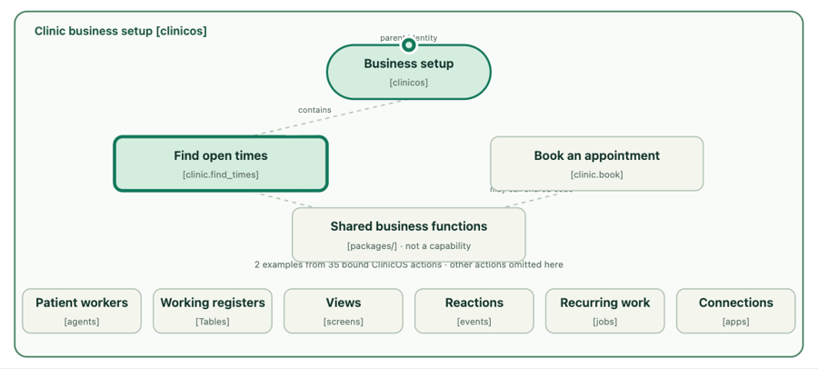

# Keemakr visual guide

[Open the live guide](https://keemakr-visual-guide.vercel.app/) · [All files and downloads](https://keemakr-visual-guide.vercel.app/files.html) · [Offline ZIP](https://keemakr-visual-guide.vercel.app/keemakr-guide-complete.zip)

A visual explanation of Keemakr, ClinicOS and Sales for early-stage and senior developers. Start with **Pack → actions**, then follow the same named action through its contract, registration, generated manifest, installation, discovery, permission checks, runtime handler and result.

The guide has 22 scenes, 98 default steps, 82 scenario choices, 5 Mermaid diagrams, 9 still illustrations and 7 GIFs. Playback is controlled by the reader; it supports keyboard interaction, reduced motion, mobile panning, printing and a static no-JavaScript edition.



## Read or share

The live guide is ready to share. Repository access follows this GitHub repository's visibility and organization permissions. For a fully offline copy, use the ZIP linked above, or open `files/Keemakr business operator explained.html` directly after cloning.

To serve the site locally, Python 3 is sufficient:

```sh
git clone git@github.com:fsztpartners/keemakr-visual-guide.git
cd keemakr-visual-guide
python3 -m http.server 8080 --bind 127.0.0.1
```

Open [localtest.me:8080](http://localtest.me:8080).

## Where to edit

| Location | Purpose |
| --- | --- |
| `files/build_visual_guide.py` | Main guide generator, SVG scenes, playback and accessibility |
| `files/visual_pack_scenes.py` | Pack containment, capability contracts, wiring, lifecycle, worked examples and docs/code comparison |
| `files/visual-media/` | PNG illustrations and GIF companions |
| `files/visual-media.json` | Portable media manifest |
| `files/render_guide_mermaid.cjs` | Mermaid sources and offline SVG rendering |
| `research/` | Source research and evidence pointers |
| `research/pack-capability-code-and-docs/` | Comparison of core-docs claims with owning code |
| `scripts/build_site.py` | Static-site packaging, file index and offline ZIP |
| `files/verify-visual-*.cjs` | Browser checks for scenes, variants, media and retained action identity |
| `files/Keemakr technical reference.html` | Preserved long-form reference with corrections |

Earlier builders and snapshots are retained for provenance; the commands below use the current generator.

## Rebuild and verify

Node 20.10+ and Python 3 are needed. The existing Mermaid SVGs and media are committed, so rebuilding the guide does not require access to the product repositories or a model provider.

```sh
npm ci
npm run build
npx playwright install chromium
npm test
```

If Chrome is already installed on macOS, the checks use it. Elsewhere, they use Playwright's Chromium. Set `CHROME_PATH` to select another installed executable.

To change Mermaid diagrams:

```sh
npm run render:mermaid
npm run build
```

To regenerate the screenshot and GIF companions, install Pillow, then run:

```sh
python3 -m pip install -r requirements-media.txt
npm run capture:media
npm run build
```

The build writes a lighter hosted `index.html`, a full self-contained HTML edition under `files/`, a file index and `keemakr-guide-complete.zip`. ZIPs, capture frames, dependencies, credentials and Vercel-local metadata are excluded from Git.

## Evidence and limits

Code is authoritative. The documentation repository is a comparison source, and disagreements are labeled as teaching omissions, documentation drift, implementation gaps or missing verification.

The source review used these snapshots on 25 November 2026:

| Repository | Snapshot |
| --- | --- |
| Keemakr `v2` | `b5f3402e71a983cecb12061511eb88714cdd1ba4` |
| ClinicOS | `eb6043f2669d671ca701581478c2d6872ded4d0a` |
| Sales | `147eff267d6fe236ad84879ffcd354a31afcb9a6` |
| core-docs | `678902df0accca44133c4b5a3a855839fbe50d67` |

Historical absolute source paths in evidence notes identify the inspected files; they are citations, not build dependencies. Links to private source repositories require access to those repositories. This repository contains the explanatory artifact, not the Keemakr or ClinicOS product code.

Browser checks validate the guide. They do not prove a live business's configuration, provider effects, production latency or HIPAA compliance. Examples are synthetic.

## Hosting

Production: [keemakr-visual-guide.vercel.app](https://keemakr-visual-guide.vercel.app/), Vercel project `fsztpartners/keemakr-visual-guide`.

An authorized maintainer can deploy a rebuilt snapshot:

```sh
npm run build
npx vercel deploy --prod --scope fsztpartners --project keemakr-visual-guide --local-config ./vercel.json
```

Use the explicit local configuration so the static guide cannot inherit a different project's serverless-function settings.
